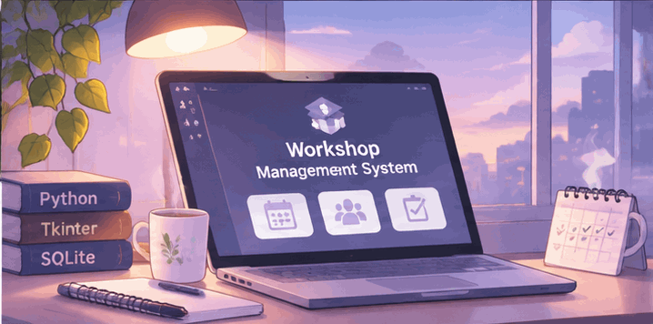

<p align="center">
  
</p>

<h1 align="center">Workshop Management System</h1>

<p align="center">
  A desktop application for university workshop management, scheduling, and student bookings.
</p>

<p align="center">
  
  
  
  
</p>

---

## Overview

**Workshop Management System** is a collaborative university project developed in Python.

The application simplifies workshop administration and student registration through a desktop interface, with separate experiences for students and administrators.

It uses SQLite for local data storage and supports workshop bookings and CSV data exports.

## Key Features

| Student Portal | Administrator Portal |
|---|---|
| Account registration and login | Administrator login |
| Browse available workshops | Create and manage workshops |
| Book workshop seats | View workshop information |
| View upcoming bookings | Export database tables to CSV |

The booking service checks seat availability within a SQLite transaction to reduce conflicting reservations.

## Technology

| Technology | Purpose |
|---|---|
| Python 3 | Application logic |
| Tkinter / ttk | Desktop user interface |
| SQLite | Local relational database |
| CSV | Data export and backups |

## Application in Action

A visual walkthrough of the application, from database initialization to workshop management.

### 01 — Database Initialization

Initialize the local SQLite database:

```bash
python setup_database.py
```

### 02 — Launch the Application

Start the desktop interface:

```bash
python login.py
```

### 03 — Student Experience

Students can register, browse workshops, reserve available seats, and review their bookings.

### 04 — Administrator Experience

Administrators can manage workshop listings, view workshop information, and export database records.

> Actual execution screenshots will be added after capturing the running application.

## Getting Started

### 1. Clone the repository

```bash
git clone https://github.com/chadiwala/KSU-Workshop-Management-System.git
```

### 2. Navigate to the project

```bash
cd KSU-Workshop-Management-System
```

### 3. Initialize the database

```bash
python setup_database.py
```

### 4. Run the application

```bash
python login.py
```

**Requirements:** Python 3 with Tkinter support. No additional third-party Python packages are required by the current source files.

## Project Structure

```text
KSU-Workshop-Management-System/
│
├── login.py
├── signup.py
├── student_window.py
├── admin_window.py
│
├── booking_service.py
├── my_workshops_service.py
├── workshop_db.py
│
├── setup_database.py
├── backup_service.py
│
├── README.md
└── assets/
```

## Database Architecture

The application uses four SQLite tables:

| Table | Description |
|---|---|
| `students` | Student accounts |
| `admins` | Administrator accounts |
| `workshops` | Workshop information and capacities |
| `bookings` | Student workshop reservations |

The database file is excluded from the public repository to protect account and booking data.

## Team & Contributions

This application was developed as a collaborative university Python project.

Each team member contributed to the development and integration of different application components.

Individual contributions and credits can be documented here with the team's agreement.

## Project Notes

- Developed as a local desktop application.
- Uses SQLite instead of an external database server.
- Supports CSV data exports.
- Intended as an academic software development project.
- Security and data handling should be reviewed before production deployment.

---

<p align="center">
  <b>Built with Python, teamwork, and a passion for software development.</b>
</p>
